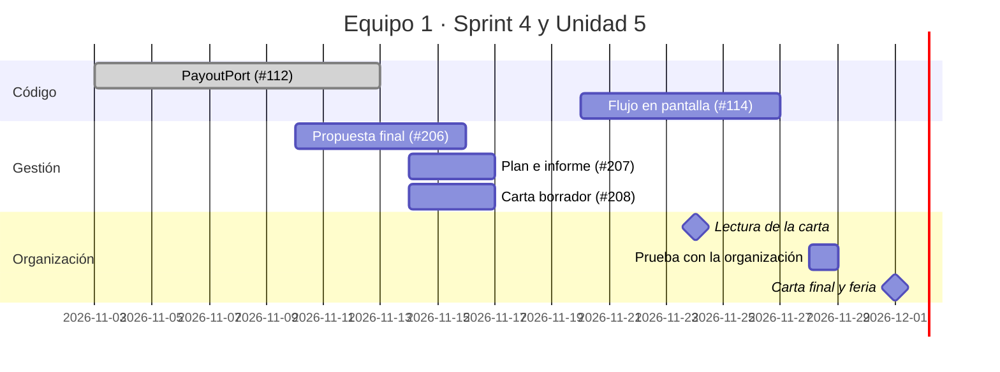

# Propuesta final · Equipo 1

**Módulo:** cobro en pesos desde la cuenta de la artesana: puerto `PayoutPort` ([#112](https://github.com/Open-Hub-Tec/yucu-protocol/issues/112), ya fusionado en el PR [#239](https://github.com/Open-Hub-Tec/yucu-protocol/pull/239)) y su flujo en pantalla "Ya estoy en la tienda" ([#114](https://github.com/Open-Hub-Tec/yucu-protocol/issues/114)).
**Organización:** <!-- TODO: nombre de la organización mixteca (nunca nombres de personas) -->
**Equipo:** <!-- TODO: @eduScrumMaster (eduScrum Master), @integrante2, @integrante3, @integrante4 -->
**Issue:** [#197](https://github.com/Open-Hub-Tec/yucu-protocol/issues/197) · Sub-issue [#206](https://github.com/Open-Hub-Tec/yucu-protocol/issues/206)

> Yucu es un **prototipo** en red de prueba (testnet). Nada de lo que aquí se describe está en uso real con dinero ni ha sido revisado por una auditoría externa.

## Resumen ejecutivo

<!-- TODO: media página como máximo (350 palabras o menos). El costo total y la fecha deben ser idénticos a los de las secciones 5 y 6. -->

**Problema.** Las artesanas de <!-- TODO: organización --> reciben el pago de sus ventas por intermediarios o en efectivo diferido. <!-- TODO: ajustar con lo que observaron en campo (sección 2). -->

**Solución.** Un flujo en la app Yucu para que la artesana cobre en pesos, en efectivo, **desde su propia cuenta** y sin esperar a nadie: cuando ya está en la tienda, elige la tienda, firma con su PIN (o con su tarjeta QR en el celular de la promotora) y recibe un código de cobro que vale 15 minutos. Si no lo cobra, el dinero regresa a su cuenta.

**Quién se beneficia.** Las artesanas de la organización y su persona de confianza (promotora).

**Costo total:** $14,400 MXN (120 horas de trabajo de estudiantes; la organización no paga nada).
**Fecha de entrega:** 1 de diciembre de 2026 (Feria de Integración).

## Problema y contexto

<!-- TODO: problema REAL de la organización, con evidencia de campo de la sesión de trabajo del Sprint 1. Sin nombres, voces ni fotos: solo rol y comunidad (PRIVACIDAD.md). -->

- **Organización y oficio:** <!-- TODO: qué producen, cuántas socias aproximadamente, comunidad -->
- **Cómo cobran hoy:** <!-- TODO -->
- **Citas anónimas:**
  - > "<!-- TODO: cita -->" — <!-- TODO: rol, comunidad (ej. artesana de textil, comunidad X) -->
  - > "<!-- TODO: cita -->" — <!-- TODO: rol, comunidad -->
- **Cifras y observaciones:** <!-- TODO: p. ej. tiempo o distancia para cobrar, porcentaje que se queda el intermediario, cuántas tienen celular propio -->

## Objetivo SMART y alcance

**Objetivo SMART** <!-- TODO: revisar contra el objetivo del Sprint 3 -->

| Letra | Cómo se cumple |
|---|---|
| **S** (específico) | Una artesana completa, en la versión simulada de Yucu, el flujo "Ya estoy en la tienda": elige la tienda, firma y obtiene su código de cobro de 15 minutos. |
| **M** (medible) | Al menos 3 de 5 socias voluntarias completan el flujo sin ayuda en menos de 5 minutos durante la prueba con la organización. <!-- PROPUESTA: confirmar meta con el equipo --> |
| **A** (alcanzable) | El puerto `PayoutPort` y su versión simulada ya están hechos y probados (PR #239); falta la pantalla (#114). |
| **R** (relevante) | Responde al problema de la sección 2: cobrar sin intermediarios y sin depender de otra persona. |
| **T** (temporal) | Listo y probado con la organización antes del 1 de diciembre de 2026. |

**El módulo incluye:**
- Puerto `PayoutPort` (`quote`, `prepareCashout`, `submit`, `getStatus`) con versión simulada y pruebas (#112, terminado).
- Pantallas del flujo "Ya estoy en la tienda" para personas mayores: botones de 56 px o más, textos de máximo dos renglones (#114).
- Firma con PIN o con tarjeta QR; el código de cobro no se guarda en el teléfono.
- Regreso del dinero a la cuenta de la artesana si el código vence.

**No incluye (fuera del alcance):**
- Conexión real con proveedores de efectivo (MicoPay) o SPEI (Etherfuse): eso son otras issues (#145, #146).
- Uso con dinero real o en red principal (mainnet).
- Registro de lotes, catálogo o escrow.
- Garantía de ventas o ingresos.

## Solución y uso de Stellar

**Qué se construye.** El cobro en pesos pasa por un puerto (`PayoutPort`, en `src/core/chain/ports.ts`) para que la pantalla no dependa del proveedor ([ADR-004](../../adr/ADR-004-PAGOS-EN-PESOS-SIN-BILLETERA.md), D9). Sigue el patrón obligatorio de Yucu: **preparar → firmar en el teléfono → enviar**. El servidor nunca toca llaves ni dinero ([ADR-003](../../adr/ADR-003-NO-CUSTODIAL-Y-TRUSTLESS-WORK.md)).

**Por qué ayuda Stellar.**
- El dinero de la venta llega directo a la cuenta de la artesana, sin que el grupo ni Yucu lo retengan.
- Comisiones de red muy bajas y confirmación en segundos.
- Red de puntos de cobro en efectivo (anclas como MicoPay) que convierte el saldo en pesos.
- La artesana nunca ve cripto: solo ve el monto en pesos (ADR-004).

**Qué es real, qué es demostración y qué está pendiente** (según la tabla de estado del [README](https://github.com/Open-Hub-Tec/yucu-protocol#implementation-status)):

| Parte | Estado |
|---|---|
| `PayoutPort` y `SimulatedPayout` con pruebas | ✅ Real como código; los resultados son simulados (`source: 'simulated'`) |
| Pantalla "Ya estoy en la tienda" (#114) | ⏳ Pendiente, Unidad 5 |
| Cotización en pesos, código de cobro y su vencimiento | 🟡 Demostración: la versión simulada los inventa y la app muestra `<DemoBadge />` |
| Conexión con MicoPay / Etherfuse | ⏳ Pendiente (otras issues) |
| Dinero real o mainnet | ❌ No está en el alcance |

## Plan de trabajo y cronograma

<!-- TODO: confirmar responsables y fechas. Cada fila necesita fecha y @usuario. -->

| # | Entregable | Cómo se verifica | Fecha | Responsable |
|---|---|---|---|---|
| E1 | `PayoutPort` + versión simulada + pruebas (#112) | PR #239 fusionado; `npm test` en verde | 2026-11-13 | <!-- TODO: @usuario --> |
| E2 | Propuesta final (#206) | PR con `Resolves #206` aprobado | 2026-11-16 | <!-- TODO: @usuario --> |
| E3 | Plan de informe e informe semana 1 (#207) | PR con `Resolves #207` aprobado | 2026-11-17 | <!-- TODO: @usuario --> |
| E4 | Borrador de carta de entendimiento (#208) | PR `Refs #208` revisado por el Equipo 3 | 2026-11-17 | <!-- TODO: @usuario --> |
| E5 | Pantallas del flujo "Ya estoy en la tienda" (#114) | PR con pruebas: flujo feliz, vencimiento, PIN equivocado | 2026-11-27 | <!-- TODO: @usuario --> |
| E6 | Prueba del flujo con la organización | Minuta en `minutas/` con resultados | 2026-11-28 | <!-- TODO: @usuario --> |
| E7 | Carta final leída en asamblea (#208) | PR `Resolves #208` con estado y minuta | 2026-12-01 | <!-- TODO: @usuario --> |
| E8 | Presentación en la Feria de Integración | Demo en vivo con la versión simulada | 2026-12-01 | <!-- TODO: @usuario --> |

<!-- TODO: ajustar las fechas de inicio del Gantt a las reales. -->

## Presupuesto y personal

<!-- PROPUESTA: horas estimadas por el asistente a partir de la complejidad de cada entregable. Si tienen las estimaciones del Sprint 3 y el costo de calidad del Sprint 2, reemplácenlas y recalculen. -->

**Tarifa por hora:** $120 MXN. Es una tarifa de referencia de desarrollador junior en México: un sueldo mensual aproximado de $19,200 MXN entre 160 horas al mes. <!-- TODO: citar la fuente que usen (bolsa de trabajo o encuesta salarial) -->

| Entregable | Horas | Tarifa | Costo |
|---|---|---|---|
| E1 · PayoutPort (#112) | 20 | $120 | $2,400 |
| E2 · Propuesta final | 12 | $120 | $1,440 |
| E3 · Plan e informe | 10 | $120 | $1,200 |
| E4 / E7 · Carta de entendimiento | 10 | $120 | $1,200 |
| E5 · Flujo en pantalla (#114) | 30 | $120 | $3,600 |
| E6 · Prueba con la organización (4 integrantes × 4 h, incluye traslado) | 16 | $120 | $1,920 |
| E8 · Feria de Integración | 10 | $120 | $1,200 |
| Costo de calidad (revisiones de PR, pruebas y retrabajo, 10 % del trabajo) | 12 | $120 | $1,440 |
| **Total** | **120** | | **$14,400 MXN** |

**Horas por integrante**

| Integrante | Rol | Horas |
|---|---|---|
| <!-- TODO: @usuario --> | eduScrum Master | 30 |
| <!-- TODO: @usuario --> | <!-- TODO: rol --> | 30 |
| <!-- TODO: @usuario --> | <!-- TODO: rol --> | 30 |
| <!-- TODO: @usuario --> | <!-- TODO: rol --> | 30 |
| **Total** | | **120** |

La organización no paga nada. Las horas las aportan los estudiantes dentro de la materia, así que el proyecto no necesita financiamiento externo. Los gastos de traslado a la comunidad los cubre el equipo. <!-- TODO: confirmar -->

## Riesgos y viabilidad

**Dictamen:** Go condicionado. <!-- PROPUESTA: si en el Sprint 3 decidieron otra cosa, usen esa -->

**Justificación:** el costo total ($14,400 MXN) son horas de estudiantes dentro de la materia: no hace falta financiamiento externo y la organización no paga nada. La parte más difícil, el puerto `PayoutPort`, ya está terminada (PR #239). Seguimos con dos condiciones:
1. Que la organización escuche la carta el 24 de noviembre y acepte hacer la prueba.
2. Que las pantallas de #114 estén terminadas el 27 de noviembre. Si no, la prueba se hace con un prototipo en papel.

<!-- PROPUESTA: probabilidad e impacto estimados por el asistente; ajústenlos con su matriz del Sprint 3. -->

| Riesgo | Probabilidad | Impacto | Respuesta | Dueño |
|---|---|---|---|---|
| Si no hay señal en la comunidad el día de la prueba, entonces no se puede mostrar el flujo en vivo. | Alta | Medio | Llevar la app instalada (PWA) con la versión simulada, que funciona sin conexión, y una hoja impresa con las pantallas. | <!-- TODO: @usuario --> |
| Si la asamblea necesita más tiempo para consultar la carta, entonces no estará firmada el 1 de diciembre. | Media | Bajo | No apresurar la firma; entregar con estado "en consulta de asamblea", minuta y fecha de la siguiente reunión. | <!-- TODO: @usuario --> |
| Si las pantallas de #114 no quedan antes de la prueba, entonces la organización no puede probar el flujo completo. | Media | Alto | Priorizar el flujo feliz y probar con un prototipo en papel. | <!-- TODO: @usuario --> |
| Si las artesanas no entienden el código de cobro de 15 minutos, entonces podrían perder el cobro. | Media | Medio | Probar los textos con ellas y mostrar el tiempo restante en grande; si vence, el dinero regresa a su cuenta. | <!-- TODO: @usuario --> |

## Evidencia y siguientes pasos

**Evidencia que se puede revisar**
- Código del módulo: PR [#239](https://github.com/Open-Hub-Tec/yucu-protocol/pull/239) (`PayoutPort`, fusionado el 13 de noviembre de 2026) y pruebas en [`src/tests/chain_ports.test.ts`](https://github.com/Open-Hub-Tec/yucu-protocol/blob/main/src/tests/chain_ports.test.ts).
- Bitácora de entrevistas: <!-- TODO: enlace al resumen anónimo en docs/research/ o a la issue del Sprint 1 -->
- Historias de usuario (Sprint 1): <!-- TODO: enlace -->
- Plan de calidad (Sprint 2): <!-- TODO: enlace -->
- Objetivo SMART, estimaciones y matriz de riesgos (Sprint 3): <!-- TODO: enlace -->
- Prototipo: <!-- TODO: enlace al prototipo o capturas sin personas -->
- Tablero del equipo: <!-- TODO: enlace al GitHub Project -->
- Carta de entendimiento: [`carta.md`](./carta.md), estado <!-- TODO: borrador / en consulta de asamblea / firmada -->.

**Siguientes pasos**

| Paso | Fecha | Responsable |
|---|---|---|
| Pedir asignación de #114 y abrir rama | 2026-11-21 | <!-- TODO: @usuario --> |
| Leer la carta a la organización | 2026-11-24 | <!-- TODO: @usuario --> |
| Prueba del flujo con la organización | 2026-11-28 | <!-- TODO: @usuario --> |
| Carta final y presentación en la Feria de Integración | 2026-12-01 | <!-- TODO: @usuario --> |

## Ética y datos personales

- Seguimos el aviso de privacidad del repositorio: [PRIVACIDAD.md](../../research/PRIVACIDAD.md). En este documento no hay nombres, voces, fotos, teléfonos ni números de control; las personas de la comunidad aparecen solo por rol y comunidad, y los integrantes solo con su `@usuario`.
- El puerto `PayoutPort` no recibe ni devuelve nombres de personas ni llaves secretas.
- Esta propuesta **no promete** ventas, ingresos ni certificaciones. Yucu es un prototipo en red de prueba: no se usa con dinero real ni tiene revisión de seguridad externa.
